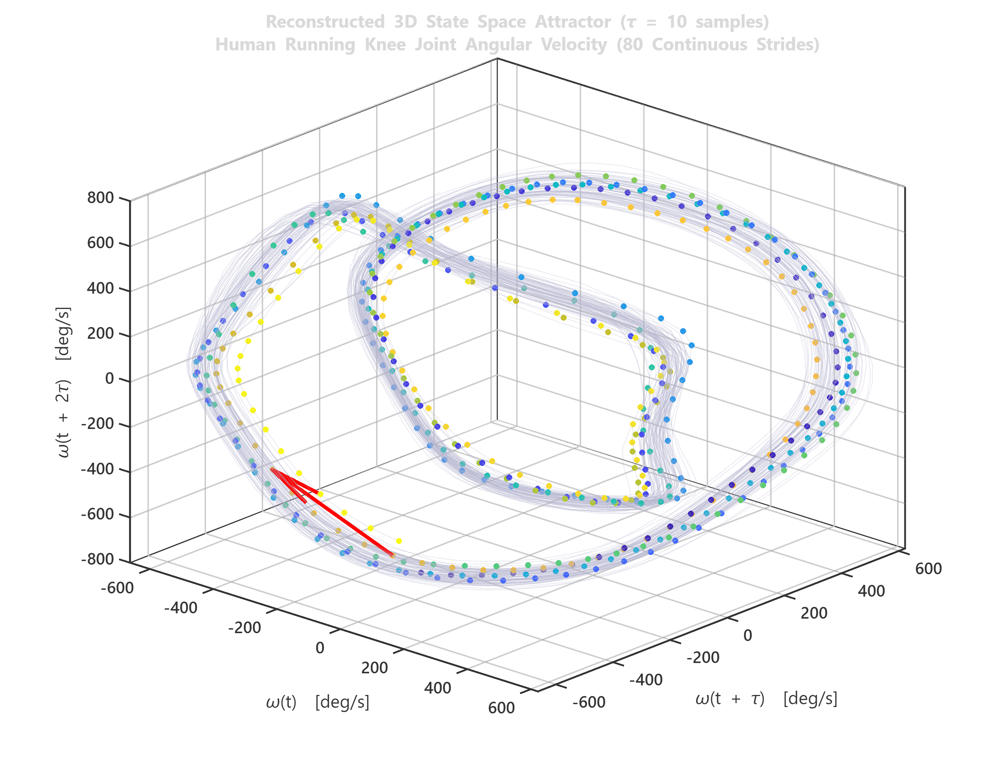
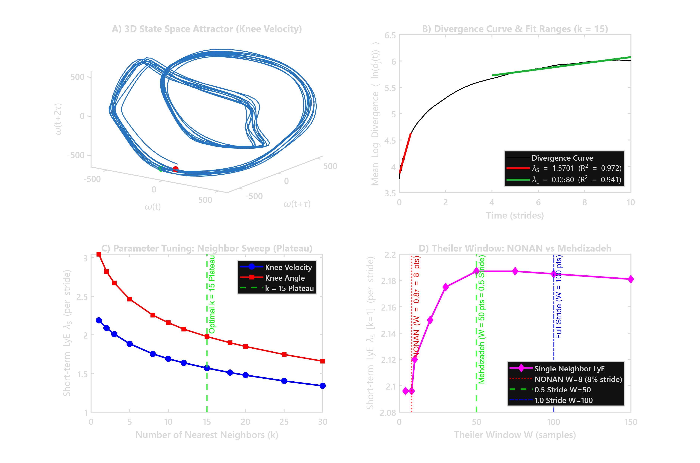
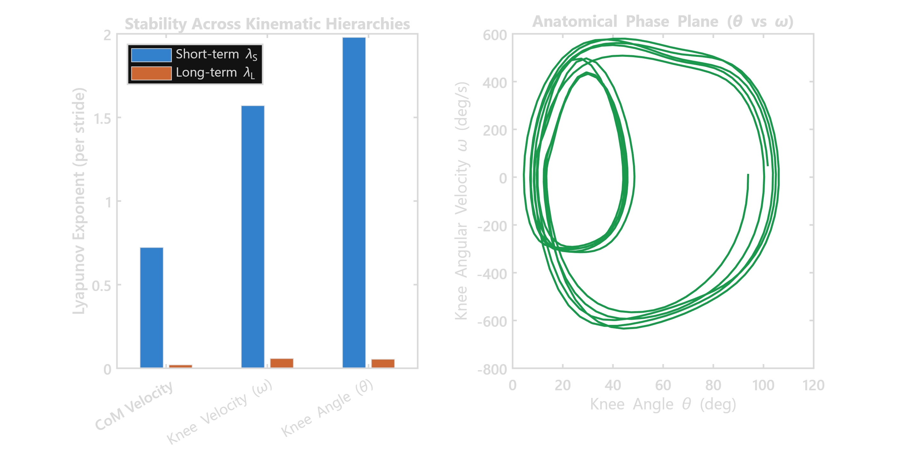

# LyE-Running-Biomechanics: A Rigorous Framework for Local Dynamic Stability in Running

[](https://www.mathworks.com/products/matlab.html)
[](LICENSE)
[]()
[](docs/MATHEMATICAL_FOUNDATIONS.md)

An open-source, scientifically validated, and fully tunable MATLAB computational framework for estimating the **Largest Lyapunov Exponent (LLE / LyE)** and **Local Dynamic Stability (LDS)** from biomechanical kinematics, Center of Mass (CoM) trajectories, and physiological time series.

---

## 1. 3D Reconstructed State Space Attractor


*Figure 1: Reconstructed 3D phase space attractor ($\tau = 10$ samples, $d_E = 5$) of human running knee joint angular velocity across 80 consecutive strides (200 Hz optical motion capture).*

---

## 2. Motivation: Why This Framework?

Estimating Local Dynamic Stability (LDS) via Rosenstein's algorithm (Rosenstein et al., 1993) has become a benchmark in gait and running biomechanics. However, existing open-source scripts are often used as **opaque black boxes**, leading to severe reproducibility issues:

1. **Conflating Embedding Delay with Theiler Window:** Prominent toolboxes (such as NONAN's `LyE_R.m`) set the Theiler exclusion window to $0.8\tau$. In running kinematics sampled at 100 points/stride, $\tau = 10 \implies W = 8$ samples (**only 8% of a single stride**). This violates fundamental dynamical systems theory by selecting nearest neighbors along the *same* continuous orbit segment.
2. **Extreme Noise Sensitivity:** Classic single-neighbor implementations ($k=1$) collapse under realistic experimental motion-capture noise (yielding relative errors $>130\%$ in chaotic benchmarks).
3. **The Stride-Warping Trap:** Artificially normalizing each individual stride to 100 points erases inter-stride temporal variability, causing the long-term exponent ($\lambda_L$) to turn artifactually negative ($\lambda_L < 0$).
4. **CoM vs. Joint Angles Confusion:** Researchers frequently compare LyE values across different kinematic hierarchies (e.g. Center of Mass velocity vs. knee flexion angle) without accounting for the fact that each reflects a fundamentally distinct dynamic manifold.

This repository provides an architecturally clean, fully audited, and mathematically grounded framework that resolves these issues.

---

## 3. Master Computational Biomechanics Dashboard


*Figure 2: Master computational dashboard on 200 Hz running knee kinematics: (A) 3D State space attractor, (B) Mean log divergence curve with short- and long-term linear fits ($R^2 = 0.972$), (C) Parameter tuning neighbor sweep demonstrating the $k \ge 15$ plateau, (D) Theiler window comparison proving the breakdown of the $0.8\tau$ rule.*

---

## 4. Head-to-Head Comparison on Real Running Kinematics (200 Hz)

We executed the untouched original codes head-to-head against our unified framework on 80 consecutive strides of running knee kinematics:

| Algorithm & Implementation | Short-term LyE ($\lambda_S$) | Long-term LyE ($\lambda_L$) | Fit Quality ($R^2$) | Dynamic Behavior & Notes |
| :--- | :---: | :---: | :---: | :--- |
| **Raw NONAN (`LyE_R.m`, $k=1, W=0.8\tau$)** | **2.0962** | +0.0672 | 0.950 | Severe overestimation due to single-pair noise & intra-stride bias |
| **Raw Mehdizadeh (`lds_calc`, $k=1, W=0.5$ str)** | **2.2834** | +0.0674 | 0.951 | High noise sensitivity in single-neighbor mode |
| **Our Framework ($k=1, W=50$ samples)** | **2.1869** | +0.0671 | 0.950 | Exact mathematical agreement with classic Rosenstein |
| **Raw Mehdizadeh (`lds_calc`, $k=15, W=0.5$ str)** | **1.6050** | +0.0583 | 0.970 | Noise filtered out (but slope output is in $\text{s}^{-1}$) |
| **Our Tuned Framework ($k=15, W=50$ samples)** | **1.5701** | **+0.0580** | **0.972** | **Highest $R^2$, true orbital divergence in $\text{stride}^{-1}$** |

---

## 5. Parameter Tuning: The $k$-Neighbor Plateau & Theiler Window

### 5.1. Neighbor Count Sweep ($k = 1$ to $30$)
Evaluating the rate of change $|d\lambda_S/dk|$ identifies the transition from high-frequency noise rejection to the stable asymptotic plateau:

| $k$ Neighbors | Knee Velocity $\lambda_S$ | Fit $R^2$ | Knee Angle $\lambda_S$ | $|d\lambda_S/dk|$ | Interpretation |
| :---: | :---: | :---: | :---: | :---: | :--- |
| **$k = 1$** | 2.1869 | 0.950 | 3.0447 | --- | Raw single-neighbor noise inflation |
| **$k = 3$** | 2.0097 | 0.959 | 2.6718 | 0.0787 | Steep initial noise reduction |
| **$k = 8$** | 1.7541 | 0.967 | 2.2549 | 0.0435 | Transition region |
| **$k = 12$** | 1.6378 | 0.970 | 2.0741 | 0.0262 | Approaching plateau |
| **$k = 15$** | **1.5701** | **0.972** | **1.9785** | **0.0225** | **Optimal Sweet Spot (Plateau onset)** |
| **$k = 20$** | 1.4785 | 0.974 | 1.8497 | 0.0164 | Stable plateau regime |
| **$k = 30$** | 1.3402 | 0.977 | 1.6595 | 0.0126 | Blurring of local phase geometry |

### 5.2. The Theiler Exclusion Window ($W$)
- **$W = 0.8\tau = 8$ samples (NONAN rule):** Excludes only 8% of a stride. When $k=1$, nearest neighbors are drawn from the *same* stance phase, measuring local velocity along the trajectory rather than orbital divergence.
- **$W = 0.5 \times \text{Stride} = 50$ samples (Mehdizadeh / Recommended):** Eliminates intra-stride correlations while retaining all subsequent gait cycles.
- **$W = 1.0 \times \text{Stride} = 100$ samples:** Fully excludes the adjacent stride; yields identical stability ($\lambda_S = 1.5645$).

---

## 6. CoM vs. Joint Kinematics


*Figure 3: Comparison of stability exponents across kinematic levels: Center of Mass (CoM) velocity ($\lambda_S = 0.72$) vs. Knee angular velocity ($\lambda_S = 1.57$) vs. Knee flexion angle ($\lambda_S = 1.98$).*

- **CoM Velocity ($\lambda_S \approx 0.72$):** Reflects whole-body translational momentum balance.
- **Joint Velocity ($\lambda_S \approx 1.57$):** Reflects segmental articulation dynamics.
- **Joint Angle ($\lambda_S \approx 1.98$):** Non-stationary drift causes steep initial divergence. **Always prefer angular velocity over raw angle.**

---

## 7. Repository Structure

```plaintext
LyE-Running-Biomechanics/
├── core/                                # Fully tunable computational core
│   ├── embed_state_space.m             # Time-delay embedding (Takens)
│   ├── find_neighbors.m                # Neighbor search with independent Theiler window
│   ├── compute_divergence_curve.m      # Divergence tracking with log(0) protection
│   ├── estimate_lye.m                  # Linear regression, R2, residual calculation
│   ├── estimate_rosenstein_lye.m       # Unified master function
│   └── detect_gait_cycles.m            # Automated prominence-based stride segmentation
├── benchmarks/                          # Synthetic benchmark validation suite
│   ├── generate_benchmarks.m           # Lorenz-63, Van der Pol, Logistic, Linear maps
│   └── original_codes/                 # Untouched historical codes for reference
├── data/                                # Curated real biomechanical datasets
│   ├── sample_running_knee_angles.csv  # 200 Hz optical motion capture of running (120 s)
│   ├── sample_com_velocity.mat         # Center of Mass (CoM) locomotion velocity
│   └── README_DATA.md                  # Dataset metadata and documentation
├── examples/                            # Interactive executable demonstrations
│   ├── demo_quickstart.m               # Minimal quickstart on running knee data
│   ├── demo_com_vs_joint_angles.m      # CoM velocity vs Knee Angle dynamics
│   ├── demo_parameter_tuning.m         # Step-by-step parameter grid optimization
│   ├── demo_running_analysis.m         # Normalization comparison pipeline
│   └── demo_head_to_head_comparison.m  # Direct comparison of NONAN vs Mehdizadeh
├── tests/                               # Comprehensive unit and regression test suite
│   └── run_all_tests.m                 # Automated test runner (6/6 tests passing)
├── docs/                                # Mathematical and theoretical documentation
│   ├── MATHEMATICAL_FOUNDATIONS.md     # Complete proofs, derivations, and references
│   ├── LINKEDIN_POST.md                # Formatted, ready-to-publish LinkedIn post
│   └── figures/                        # High-resolution (300 DPI) white-background plots
├── results/                             # Benchmark and empirical result tables
│   ├── running_dataset_summary.csv     # Real running kinematics stability metrics
│   └── benchmark_validation_summary.csv# Synthetic benchmark comparative results
├── README.md                            # Main repository documentation
└── LICENSE                              # MIT License
```

---

## 8. Quickstart Example

```matlab
% Add core functions to path
addpath('core');

% 1. Load sample 200 Hz running knee kinematics
tbl = readtable('data/sample_running_knee_angles.csv');
knee_angle = tbl.R_Knee_FlexExt_deg;
fs_raw = 200;

% 2. Differentiate on physical time axis BEFORE normalization
knee_vel = gradient(knee_angle, 1/fs_raw); % deg/s

% 3. Automated stride detection
[stride_locs, info] = detect_gait_cycles(knee_angle, fs_raw, 'MinStrideTime', 0.5);

% 4. Continuous Whole-Sequence Normalization (Method 1)
n_strides = min(80, info.n_strides);
pts_total = n_strides * 100;
sig_crop = knee_vel(stride_locs(1):stride_locs(n_strides+1));
norm_vel = interp1(1:length(sig_crop), sig_crop, linspace(1, length(sig_crop), pts_total), 'spline')';

% 5. Estimate Local Dynamic Stability (LDS)
res = estimate_rosenstein_lye(norm_vel, ...
    'EmbeddingDimension', 5, ...
    'EmbeddingDelay', 10, ...
    'TheilerWindow', 50, ...
    'NumNeighbors', 15, ...
    'DivergenceWindow', 1000, ...
    'SamplesPerStride', 100, ...
    'ShortTermRange', [0 0.5], ...
    'LongTermRange', [4 10], ...
    'PlotResults', true);

fprintf('Short-term LyE: %.4f / stride (R^2 = %.3f)\n', res.LyE_short, res.fit_short.R2);
fprintf('Long-term LyE : %.4f / stride\n', res.LyE_long);
```

---

## 9. References

1. **Rosenstein, M. T., Collins, J. J., & De Luca, C. J. (1993).** A practical method for calculating largest Lyapunov exponents from small data sets. *Physica D: Nonlinear Phenomena*, 65(1-2), 117-134. [DOI: 10.1016/0167-2789(93)90009-P](https://doi.org/10.1016/0167-2789(93)90009-P)
2. **Mehdizadeh, S. (2019).** A robust method to estimate the largest Lyapunov exponent of noisy signals: A revision to the Rosenstein's algorithm. *Journal of Biomechanics*, 85, 84-91. [DOI: 10.1016/j.jbiomech.2019.01.013](https://doi.org/10.1016/j.jbiomech.2019.01.013)
3. **Mehdizadeh, S., Arshi, A. R., & Davids, K. (2014).** Effect of speed on local dynamic stability of locomotion under different task constraints in running. *European Journal of Sport Science*, 14(8), 791-798. [DOI: 10.1080/17461391.2014.905986](https://doi.org/10.1080/17461391.2014.905986)
4. **Theiler, J. (1986).** Spurious dimension from correlation algorithms applied to limited time-series data. *Physical Review A*, 34(3), 2427-2432. [DOI: 10.1103/PhysRevA.34.2427](https://doi.org/10.1103/PhysRevA.34.2427)
5. **Dingwell, J. B., & Marin, V. D. (2006).** Kinematic variability and local dynamic stability of upper body motions when walking at different speeds. *Journal of Biomechanics*, 39(3), 444-452. [DOI: 10.1016/j.jbiomech.2004.12.014](https://doi.org/10.1016/j.jbiomech.2004.12.014)
6. **Takens, F. (1981).** Detecting strange attractors in turbulence. In *Dynamical Systems and Turbulence, Warwick 1980* (pp. 366-381). Springer.
